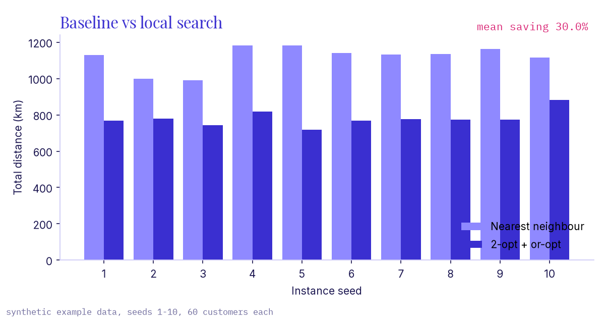
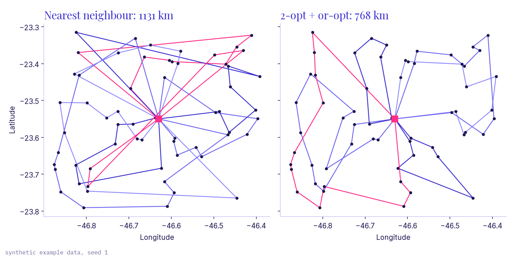

# route-optimizer

Delivery routes with capacity and time windows (VRPTW): build them with nearest
neighbour, then improve them with 2-opt and or-opt, and estimate fuel per route
from the forces on the truck.

## Problem

Nearest neighbour ("go to the closest stop that still fits") gives feasible
routes fast, but they cross themselves and use more trucks than needed. The
question here is how much a simple local search recovers while keeping every
window and capacity limit, measured in km and in litres.

## Method

- Distances: haversine great-circle km × 1.3 detour factor for streets.
- Constraints: hard time windows (arriving early means waiting), 10 min service
  per stop, truck capacity, fleet limit, back at the depot before the shift ends.
- Start: nearest neighbour; a new truck opens when no customer fits.
- Improve: 2-opt inside each route, then or-opt moves of 1 to 3 stops within or
  between routes, repeated until nothing improves.
- Fuel per leg: F = Crr·m·g + ½·ρ·Cd·A·v², divided by engine efficiency and
  diesel heating value. The mass m drops at each stop, so load order matters.

Derivation and a hand check: [docs/fuel_model.md](docs/fuel_model.md).
Model and heuristics: [docs/formulation.md](docs/formulation.md).

## How to run

```bash
python -m venv .venv && . .venv/bin/activate
pip install -e ".[dev]"
route-optimizer solve -n 60 --seed 1
route-optimizer bench -n 60 --seeds 10 --csv bench.csv
pytest                 # fails below 100% coverage
ruff check . && mypy
```

Figures in `docs/img/` and `docs/benchmark.csv`: `pip install matplotlib && PYTHONPATH=src:scripts python scripts/make_charts.py` (hero: `scripts/make_hero.py`).

## Result

Ten random instances (seeds 1 to 10) around a depot in central São Paulo, 60
customers each, 20 to 150 kg per drop, 2 to 4 h windows in a 10 h shift,
1,200 kg trucks at 40 km/h. Totals from `route-optimizer bench -n 60 --seeds 10`
(per seed: [docs/benchmark.csv](docs/benchmark.csv)):

| Sum over 10 instances | Nearest neighbour | 2-opt + or-opt |
|---|---|---|
| Distance | 11,172.8 km | 7,801.2 km |
| Trucks | 85 | 63 |
| Fuel (flat-road model) | 579.8 L | 416.1 L |
| Unserved customers | 0 | 0 |

That is 30.2% less distance on the totals (the CLI prints the per-instance mean,
30.0%; worst seed 21.1%, best 39.4%) and 28.2% less fuel by the model. The fuel
figures are lower bounds and only useful for comparing the two plans.




## Limits

- Heuristic only. No optimality gap, and no comparison with Solomon or other
  published instances yet.
- Random customers, not a real network. Savings on a real plan depend on how
  good that plan already is.
- Constant detour factor and speed; no traffic, road graph or restrictions
  such as rodízio.
- The fuel model ignores acceleration, idling, grades and auxiliaries.
- Pure Python; fine for tens to low hundreds of customers.

MIT license.
