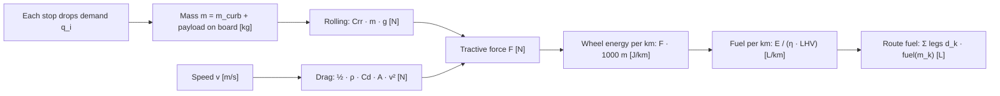

# route-optimizer

Vehicle routing with time windows and capacity (VRPTW): a nearest-neighbour
baseline, a 2-opt / or-opt local search, haversine distances and a
physics-based fuel estimate.

## What

- Distance matrix from haversine great-circle distances on synthetic
  coordinates, scaled by a road detour factor.
- Hard time windows (waiting allowed), service times, vehicle capacity, fleet
  limit.
- Baseline: nearest neighbour construction.
- Improvement: 2-opt within routes and or-opt segment moves within and between
  routes.
- Fuel per route from rolling resistance, aerodynamic drag and the payload on
  board for every leg.
- Seeded synthetic instance generator, CLI and a reproducible benchmark.

## Why

Nearest neighbour is the routing equivalent of "always go to the closest next
stop". It is fast and feasible but leaves long crossing legs. A simple local
search removes most of them while keeping every constraint, and it is easy to
read and test. The fuel model ties distance and load to energy so routes can be
compared in litres, not only kilometres.

## Physical model



Derivation, units and a hand-computed check: [docs/fuel_model.md](docs/fuel_model.md).
Optimisation model and heuristics: [docs/formulation.md](docs/formulation.md).

## How to run

```bash
python -m venv .venv && . .venv/bin/activate
pip install -e ".[dev]"
route-optimizer solve -n 60 --seed 1
route-optimizer bench -n 60 --seeds 10 --csv bench.csv
pytest            # tests with 100% coverage gate
ruff check . && mypy
pip install matplotlib && PYTHONPATH=src python scripts/make_charts.py   # refresh docs/
```

## Results (synthetic example data)

Ten seeded synthetic instances (seeds 1 to 10), 60 customers each, demand
20 to 150 kg, 2 to 4 hour windows in a 10 hour shift, capacity 1,200 kg,
40 km/h, detour factor 1.3. Per-seed numbers: [docs/benchmark.csv](docs/benchmark.csv).

| Metric, sum over 10 instances (synthetic example data) | Nearest neighbour | 2-opt + or-opt |
|---|---|---|
| Total distance | 11,172.8 km | 7,801.2 km |
| Vehicles used | 85 | 63 |
| Fuel, steady-state model | 579.8 L | 416.1 L |
| Unserved customers | 0 | 0 |

Distance saving: **30.2% overall** (21.1% to 39.4% per instance); fuel
estimate saving 28.2%. Fuel figures are lower bounds from the flat-road model
and are only meaningful for comparing routes.


## Limits and honest scope

- Heuristics only; no optimality gap is reported (no exact solver or
  published benchmark comparison yet).
- Synthetic instances are random, not drawn from real customers; savings on
  real networks depend on geography, windows and how good the existing plan is.
- Great-circle distance with a constant detour factor, constant speed, no
  traffic or road network.
- Fuel model excludes acceleration, idling, grades and auxiliaries; parameters
  are generic assumptions.
- Pure Python; fine for tens to low hundreds of customers.

## License

MIT, see [LICENSE](LICENSE).
